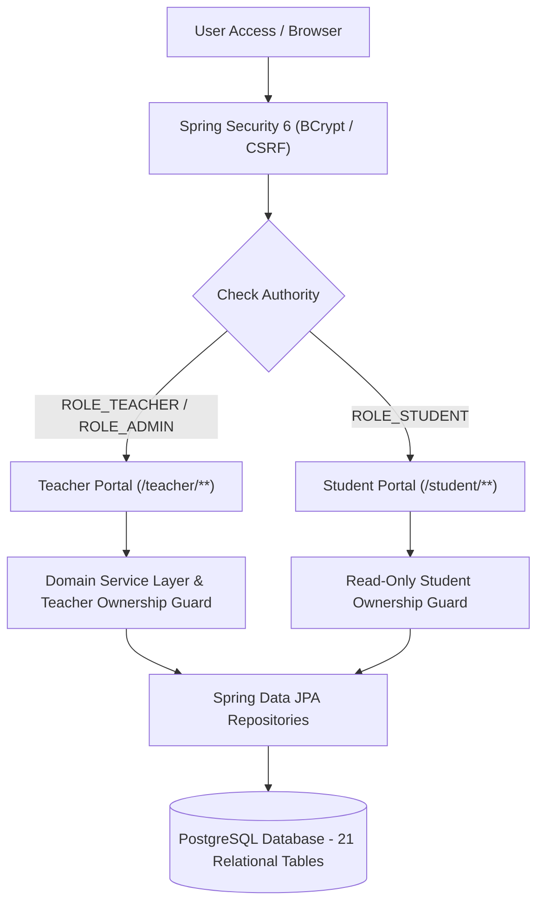

# Student Management System (SMS)
### Premium Dark Enterprise Academic Management Platform (Java 21 & Spring Boot 3)

---

## 1. System Vision

The **Student Management System (SMS)** is an enterprise academic administration platform built for a college institution. The system enforces strict architectural and security separation between two independent portals:

- **Teacher Portal:** Full instructional administration (classes, student roster, session-based attendance, exam management, draft/publish marks, configurable grading rubrics, weekly timetables with conflict detection, and academic analytics).
- **Student Portal:** Strict read-only personal academic inquiry (student profile, verified attendance rates, published examination scores, semester GPA, and live schedule).

---

## 2. Mandatory Java Technology Stack

- **Java Version:** Java 21 LTS (Eclipse Adoptium OpenJDK 21.0.13)
- **Framework:** Spring Boot 3.3.5, Spring MVC, Spring Data JPA, Hibernate, Bean Validation
- **Security:** Spring Security 6 (BCrypt password hashing, session-based RBAC, CSRF protection)
- **Database & Migrations:** PostgreSQL & Flyway Migrations (`db/migration/V1__initial_schema.sql`, `V2__seed_initial_data.sql`)
- **Frontend / Templating:** Thymeleaf, HTML5, CSS3, JavaScript, Bootstrap 5, Bootstrap Icons, Chart.js
- **Build & Dependency Tooling:** Maven & Maven Wrapper (`mvnw`, `mvnw.cmd`)
- **Testing:** JUnit 5, Mockito, Spring Security Test, MockMvc

---

## 3. Architecture & Security Model



### Institutional Role Boundaries
1. **Teacher Authority:** Teachers have read/write permissions exclusively over classes and subjects formally assigned to them.
2. **Student Read-Only Security:** Students cannot create, modify, or delete marks, attendance, or schedules. Any unauthorized mutation attempt yields an HTTP `403 Forbidden` response.
3. **Draft vs. Published Marks:** Unvalidated draft examination marks are isolated and inaccessible to students at the database query level.

---

## 4. Default Seed Credentials

Upon startup, the system automatically checks and provisions the following default demo accounts:

| Portal | Username | Password | Role | Permissions |
| :--- | :--- | :--- | :--- | :--- |
| **Teacher Portal** | `teacher` | `password123` | `ROLE_TEACHER` | Manage assigned classes, attendance, exams, marks, schedule |
| **Student Portal** | `student` | `password123` | `ROLE_STUDENT` | View own profile, attendance %, published marks, timetable |
| **Administrator** | `admin` | `password123` | `ROLE_ADMIN` | College-wide configuration and system oversight |

*Note: The login page includes quick-fill convenience buttons for both Teacher and Student accounts.*

---

## 5. Quick Start Instructions

### Prerequisites
- Java 21 LTS installed (`JAVA_HOME` configured).
- Maven 3.9+ or use the included Maven Wrapper (`.\mvnw.cmd` on Windows, `./mvnw` on Linux/macOS).

### Running the Application

```powershell
# Run using the default development profile (H2 in PostgreSQL mode, instantaneous startup):
.\mvnw.cmd spring-boot:run

# Or run with your local PostgreSQL instance:
.\mvnw.cmd spring-boot:run -Dspring-boot.run.profiles=postgres
```

### Accessing the Web Application
- **Portal Sign In:** [http://localhost:8080/login](http://localhost:8080/login)
- **Teacher Dashboard:** [http://localhost:8080/teacher/dashboard](http://localhost:8080/teacher/dashboard)
- **Student Dashboard:** [http://localhost:8080/student/dashboard](http://localhost:8080/student/dashboard)

### Running Automated Test Suites

```powershell
.\mvnw.cmd test
```
All 12 automated security tests (login authentication, role enforcement, unauthorized access prevention, CSRF validation) execute and pass with 0 failures.

---

## 6. Premium Dark Color Palette Reference

- **Canvas Background:** `#0B1020`
- **Sidebar & App Bar:** `#111827`
- **Cards & Surfaces:** `#1E293B` (Hover: `#26354A`)
- **Primary Accent:** `#3B82F6`
- **Success Accent:** `#10B981`
- **Warning Accent:** `#F59E0B`
- **Danger Accent:** `#EF4444`
- **Text Primary:** `#F8FAFC`
- **Text Secondary:** `#94A3B8`
- **Borders & Dividers:** `#334155`

