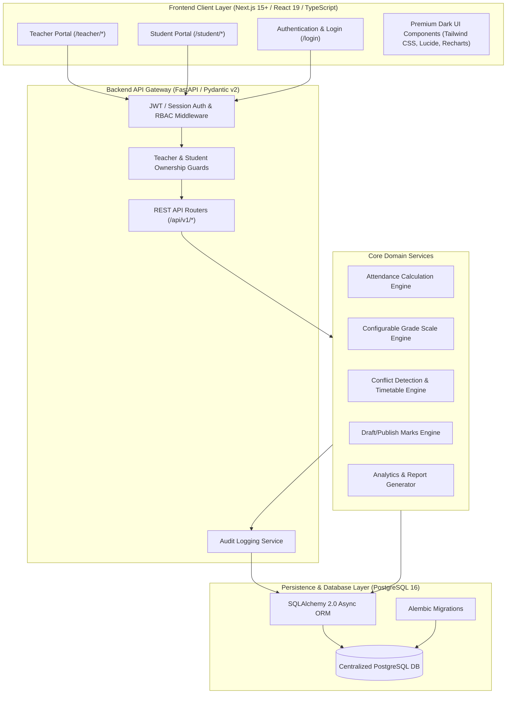
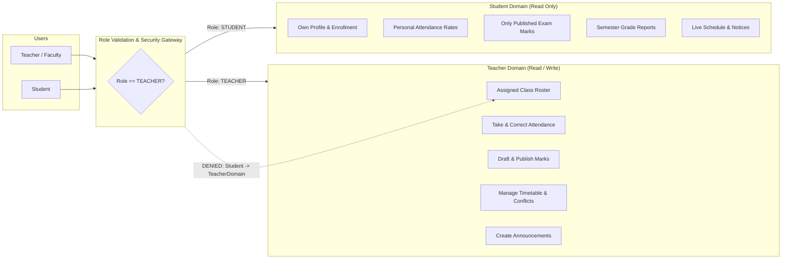
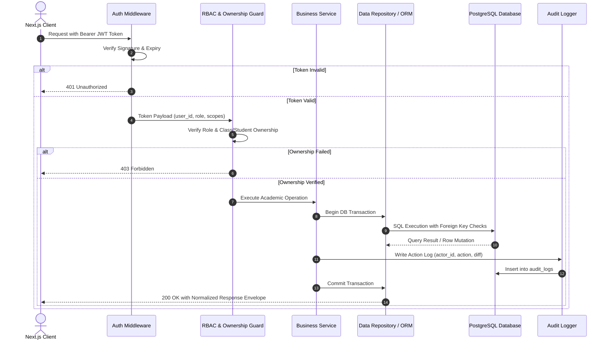

# Student Management System (SMS) - System Architecture

**Document Version:** 1.0.0  
**Phase:** Phase 0 (Planning & Architecture)  
**Status:** Approved for Implementation  

---

## 1. Executive Summary

The **Student Management System (SMS)** is an enterprise-grade academic management platform built specifically for a single college institution. The system enforces strict role-based separation between two independent portals:

1. **Teacher Portal:** Full administrative and academic authority over assigned classes, student rosters, subject allocation, session-based attendance, examinations, marks entry, configurable grading scales, weekly timetables with conflict detection, announcements, and academic analytics.
2. **Student Portal:** Read-only access for enrolled students to inspect their personal profile, subject-wise and session-wise attendance statistics, examination marks (published only), calculated grades, weekly and daily timetables, and college/class notifications.

All operations synchronize through a single centralized PostgreSQL relational database accessed via a high-performance Python FastAPI backend and rendered with a Next.js (App Router) + TypeScript + Tailwind CSS dark-enterprise web application.

---

## 2. High-Level Architecture Diagram



---

## 3. Technology Stack & Component Justification

| Layer | Technology | Version / Spec | Justification |
| :--- | :--- | :--- | :--- |
| **Frontend Framework** | Next.js (App Router) | 15.x / React 19 | Server-side rendering, layout nesting for independent portals, optimal performance, native TypeScript support. |
| **Language (FE)** | TypeScript | 5.x | Strict type safety across portals, shared API interfaces, compile-time error reduction. |
| **Styling & UI** | Tailwind CSS + CSS Variables | 3.4+ / 4.x | Complete control over the `#0B1020` Enterprise Dark palette, utility-first ergonomics, micro-interactions. |
| **Icons & Charts** | Lucide React + Recharts | Latest stable | Clean enterprise iconography and SVG responsive charting for attendance and grade distributions. |
| **Backend Framework** | FastAPI | 0.115+ | High throughput async Python, automatic OpenAPI/Swagger documentation, strict Pydantic v2 data validation. |
| **ORM & Migrations** | SQLAlchemy + Alembic | 2.0+ / 1.14+ | Production-grade async relational mapper, schema version control, complex join capabilities, transactional integrity. |
| **Database** | PostgreSQL | 15+ / 16 | ACID compliance, JSONB support where needed, strict foreign key constraints, native UUID generation (`gen_random_uuid()`). |
| **Security & Auth** | Argon2 / Passlib + PyJWT | Latest stable | Industry-standard password hashing resilient against GPU brute force; signed JWT access/refresh token pairs. |

---

## 4. Portals & Separation of Concerns



### 4.1 Teacher Portal Security Boundaries
- Teachers can only read and write data for classes and subjects formally assigned to them in `class_teachers` or `class_subjects`.
- Marks management enforces a strict lifecycle: `DRAFT` $\to$ `VALIDATED` $\to$ `PUBLISHED`. Teachers can edit drafts; published marks require an audit-logged revision workflow.
- Attendance sessions can only be initiated for dates within the active academic semester.

### 4.2 Student Portal Security Boundaries
- Students query records strictly filtered by their `student_id` derived directly from their validated authentication token (never from client-supplied URL parameters).
- Draft marks and unverified exam entries are inaccessible to students at the SQL query level (e.g., `WHERE status = 'PUBLISHED'`).
- Students have zero write access across all academic endpoints (attendance, marks, schedules, profiles).

---

## 5. Network & API Request Lifecycle



---

## 6. Directory Structure Overview

```
student-portal/
├── docs/                      # Architectural and operational documentation
│   ├── ARCHITECTURE.md
│   ├── DATABASE_SCHEMA.md
│   ├── API_DOCUMENTATION.md
│   ├── SECURITY.md
│   └── DEVELOPMENT_ROADMAP.md
├── backend/                   # FastAPI Backend
│   ├── app/
│   │   ├── api/v1/            # Versioned API routes
│   │   │   ├── endpoints/
│   │   │   └── api.py
│   │   ├── core/              # Config, security, database session
│   │   ├── models/            # SQLAlchemy 2.0 declarative models
│   │   ├── schemas/           # Pydantic v2 validation models
│   │   ├── services/          # Pure business logic engines
│   │   ├── repositories/      # Database abstraction queries
│   │   ├── permissions/       # Ownership and RBAC dependencies
│   │   └── utils/             # Helpers, formatters, exporters
│   ├── migrations/            # Alembic schema migrations
│   ├── tests/                 # Pytest automated test suites
│   ├── requirements.txt
│   └── Dockerfile
└── frontend/                  # Next.js 15 Application
    ├── app/
    │   ├── login/             # Enterprise login view
    │   ├── teacher/           # Teacher portal route group
    │   │   ├── dashboard/
    │   │   ├── students/
    │   │   ├── classes/
    │   │   ├── subjects/
    │   │   ├── attendance/
    │   │   ├── exams/
    │   │   ├── marks/
    │   │   ├── grades/
    │   │   ├── timetable/
    │   │   ├── announcements/
    │   │   ├── reports/
    │   │   └── profile/
    │   └── student/           # Student portal route group
    │       ├── dashboard/
    │       ├── profile/
    │       ├── attendance/
    │       ├── marks/
    │       ├── grades/
    │       ├── timetable/
    │       └── settings/
    ├── components/
    │   ├── ui/                # Base design system primitives
    │   ├── layout/            # Sidebar, Header, MobileNav
    │   ├── dashboard/         # Stat cards, quick links
    │   ├── tables/            # Data tables with pagination & sorting
    │   ├── charts/            # Recharts dark-theme visualizations
    │   └── forms/             # Modal dialog forms with validation
    ├── hooks/                 # Custom React hooks (auth, data, state)
    ├── services/              # Axios/Fetch API client abstractions
    ├── types/                 # Shared TypeScript interfaces
    ├── lib/                   # Utility functions & formatting
    └── package.json
```

