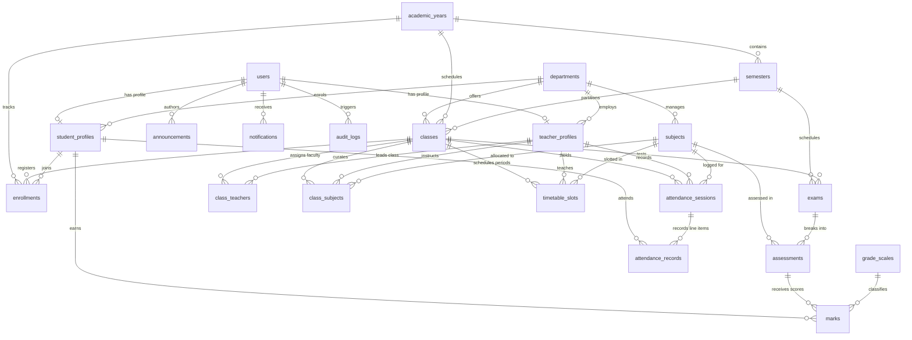

# Student Management System (SMS) - Database Architecture & Schema Specification

**Document Version:** 1.0.0  
**Phase:** Phase 0 (Planning & Architecture)  
**Database Engine:** PostgreSQL 15+ / 16  
**Primary Key Standard:** UUID v4 (`gen_random_uuid()`)  

---

## 1. Entity Relationship Diagram (ERD)

---

## 2. Comprehensive Table Specifications

### 2.1 Identity & Profile Tables

#### 1. `users`
Central credentials and authentication account table.
- `id`: `UUID` (PK, default `gen_random_uuid()`)
- `username`: `VARCHAR(100)` (UNIQUE, NOT NULL, indexed)
- `email`: `VARCHAR(255)` (UNIQUE, NOT NULL, indexed)
- `password_hash`: `VARCHAR(255)` (NOT NULL, Argon2/bcrypt hash)
- `role`: `VARCHAR(20)` (NOT NULL - `TEACHER`, `STUDENT`, `ADMIN`)
- `is_active`: `BOOLEAN` (NOT NULL, default `TRUE`)
- `created_at`: `TIMESTAMPTZ` (NOT NULL, default `NOW()`)
- `updated_at`: `TIMESTAMPTZ` (NOT NULL, default `NOW()`)

#### 2. `teacher_profiles`
Faculty details linked 1:1 with `users`.
- `id`: `UUID` (PK, default `gen_random_uuid()`)
- `user_id`: `UUID` (UNIQUE, NOT NULL, FK $\to$ `users.id` ON DELETE CASCADE)
- `employee_id`: `VARCHAR(50)` (UNIQUE, NOT NULL, indexed)
- `full_name`: `VARCHAR(150)` (NOT NULL)
- `phone_number`: `VARCHAR(20)` (NULLABLE)
- `department_id`: `UUID` (NOT NULL, FK $\to$ `departments.id` ON DELETE RESTRICT)
- `designation`: `VARCHAR(100)` (NOT NULL, e.g., 'Assistant Professor')
- `qualification`: `VARCHAR(100)` (NULLABLE)
- `profile_photo_url`: `TEXT` (NULLABLE)
- `created_at`: `TIMESTAMPTZ` (NOT NULL, default `NOW()`)
- `updated_at`: `TIMESTAMPTZ` (NOT NULL, default `NOW()`)

#### 3. `student_profiles`
Student demographic and academic registry linked 1:1 with `users`.
- `id`: `UUID` (PK, default `gen_random_uuid()`)
- `user_id`: `UUID` (UNIQUE, NOT NULL, FK $\to$ `users.id` ON DELETE CASCADE)
- `roll_number`: `VARCHAR(50)` (UNIQUE, NOT NULL, indexed - College Roll No.)
- `registration_number`: `VARCHAR(50)` (UNIQUE, NOT NULL, indexed - Univ/Board No.)
- `full_name`: `VARCHAR(150)` (NOT NULL)
- `phone_number`: `VARCHAR(20)` (NULLABLE)
- `department_id`: `UUID` (NOT NULL, FK $\to$ `departments.id` ON DELETE RESTRICT)
- `course`: `VARCHAR(100)` (NOT NULL, e.g., 'B.Tech Computer Science')
- `current_academic_year_id`: `UUID` (NOT NULL, FK $\to$ `academic_years.id`)
- `current_semester_id`: `UUID` (NOT NULL, FK $\to$ `semesters.id`)
- `profile_photo_url`: `TEXT` (NULLABLE)
- `account_status`: `VARCHAR(20)` (NOT NULL, default `'ACTIVE'` - `ACTIVE`, `INACTIVE`, `SUSPENDED`, `GRADUATED`)
- `created_at`: `TIMESTAMPTZ` (NOT NULL, default `NOW()`)
- `updated_at`: `TIMESTAMPTZ` (NOT NULL, default `NOW()`)

---

### 2.2 Academic Organization Tables

#### 4. `departments`
- `id`: `UUID` (PK)
- `code`: `VARCHAR(20)` (UNIQUE, NOT NULL, e.g., 'CSE', 'ECE')
- `name`: `VARCHAR(150)` (NOT NULL)
- `description`: `TEXT` (NULLABLE)
- `created_at`: `TIMESTAMPTZ` (NOT NULL, default `NOW()`)
- `updated_at`: `TIMESTAMPTZ` (NOT NULL, default `NOW()`)

#### 5. `academic_years`
- `id`: `UUID` (PK)
- `name`: `VARCHAR(50)` (UNIQUE, NOT NULL, e.g., '2025-2026')
- `start_date`: `DATE` (NOT NULL)
- `end_date`: `DATE` (NOT NULL)
- `is_current`: `BOOLEAN` (NOT NULL, default `FALSE`)
- `created_at`: `TIMESTAMPTZ` (NOT NULL, default `NOW()`)
- `updated_at`: `TIMESTAMPTZ` (NOT NULL, default `NOW()`)

#### 6. `semesters`
- `id`: `UUID` (PK)
- `academic_year_id`: `UUID` (NOT NULL, FK $\to$ `academic_years.id` ON DELETE CASCADE)
- `semester_number`: `INTEGER` (NOT NULL, e.g., 1, 2, 3... 8)
- `name`: `VARCHAR(50)` (NOT NULL, e.g., 'Fall Semester 2025')
- `start_date`: `DATE` (NOT NULL)
- `end_date`: `DATE` (NOT NULL)
- `is_active`: `BOOLEAN` (NOT NULL, default `FALSE`)
- `created_at`: `TIMESTAMPTZ` (NOT NULL, default `NOW()`)
- `updated_at`: `TIMESTAMPTZ` (NOT NULL, default `NOW()`)
- *Constraint:* `UNIQUE (academic_year_id, semester_number)`

#### 7. `classes`
Class / cohort groups combining department, semester, and section.
- `id`: `UUID` (PK)
- `name`: `VARCHAR(100)` (NOT NULL, e.g., 'CSE-Year3-SecA')
- `department_id`: `UUID` (NOT NULL, FK $\to$ `departments.id` ON DELETE RESTRICT)
- `academic_year_id`: `UUID` (NOT NULL, FK $\to$ `academic_years.id` ON DELETE RESTRICT)
- `semester_id`: `UUID` (NOT NULL, FK $\to$ `semesters.id` ON DELETE RESTRICT)
- `section`: `VARCHAR(10)` (NOT NULL, e.g., 'A', 'B', '1')
- `capacity`: `INTEGER` (NOT NULL, default 60)
- `created_at`: `TIMESTAMPTZ` (NOT NULL, default `NOW()`)
- `updated_at`: `TIMESTAMPTZ` (NOT NULL, default `NOW()`)
- *Constraint:* `UNIQUE (department_id, academic_year_id, semester_id, section)`

#### 8. `class_teachers`
Assigns primary teachers / class counselors to classes (ownership link).
- `id`: `UUID` (PK)
- `class_id`: `UUID` (NOT NULL, FK $\to$ `classes.id` ON DELETE CASCADE)
- `teacher_id`: `UUID` (NOT NULL, FK $\to$ `teacher_profiles.id` ON DELETE CASCADE)
- `is_primary`: `BOOLEAN` (NOT NULL, default `TRUE`)
- `created_at`: `TIMESTAMPTZ` (NOT NULL, default `NOW()`)
- *Constraint:* `UNIQUE (class_id, teacher_id)`

#### 9. `subjects`
Course catalogue.
- `id`: `UUID` (PK)
- `department_id`: `UUID` (NOT NULL, FK $\to$ `departments.id` ON DELETE RESTRICT)
- `code`: `VARCHAR(20)` (UNIQUE, NOT NULL, e.g., 'CS301')
- `name`: `VARCHAR(150)` (NOT NULL, e.g., 'Database Management Systems')
- `credits`: `NUMERIC(4, 1)` (NOT NULL, default 3.0)
- `is_elective`: `BOOLEAN` (NOT NULL, default `FALSE`)
- `created_at`: `TIMESTAMPTZ` (NOT NULL, default `NOW()`)
- `updated_at`: `TIMESTAMPTZ` (NOT NULL, default `NOW()`)

#### 10. `class_subjects`
Mapping between classes, subjects, and assigned instructor.
- `id`: `UUID` (PK)
- `class_id`: `UUID` (NOT NULL, FK $\to$ `classes.id` ON DELETE CASCADE)
- `subject_id`: `UUID` (NOT NULL, FK $\to$ `subjects.id` ON DELETE CASCADE)
- `teacher_id`: `UUID` (NOT NULL, FK $\to$ `teacher_profiles.id` ON DELETE RESTRICT)
- `created_at`: `TIMESTAMPTZ` (NOT NULL, default `NOW()`)
- *Constraint:* `UNIQUE (class_id, subject_id)`

#### 11. `enrollments`
Enrolls a student into a class for an academic session.
- `id`: `UUID` (PK)
- `student_id`: `UUID` (NOT NULL, FK $\to$ `student_profiles.id` ON DELETE CASCADE)
- `class_id`: `UUID` (NOT NULL, FK $\to$ `classes.id` ON DELETE RESTRICT)
- `academic_year_id`: `UUID` (NOT NULL, FK $\to$ `academic_years.id` ON DELETE RESTRICT)
- `status`: `VARCHAR(20)` (NOT NULL, default `'ENROLLED'` - `ENROLLED`, `TRANSFERRED`, `COMPLETED`, `DROPPED`)
- `enrolled_at`: `TIMESTAMPTZ` (NOT NULL, default `NOW()`)
- `created_at`: `TIMESTAMPTZ` (NOT NULL, default `NOW()`)
- `updated_at`: `TIMESTAMPTZ` (NOT NULL, default `NOW()`)
- *Constraint:* `UNIQUE (student_id, academic_year_id)`

---

### 2.3 Attendance Module

#### 12. `attendance_sessions`
A single attendance register session for a class period.
- `id`: `UUID` (PK)
- `class_id`: `UUID` (NOT NULL, FK $\to$ `classes.id` ON DELETE RESTRICT)
- `subject_id`: `UUID` (NOT NULL, FK $\to$ `subjects.id` ON DELETE RESTRICT)
- `teacher_id`: `UUID` (NOT NULL, FK $\to$ `teacher_profiles.id` ON DELETE RESTRICT)
- `session_date`: `DATE` (NOT NULL)
- `slot_number`: `INTEGER` (NULLABLE, period slot reference)
- `remarks`: `TEXT` (NULLABLE)
- `created_at`: `TIMESTAMPTZ` (NOT NULL, default `NOW()`)
- `updated_at`: `TIMESTAMPTZ` (NOT NULL, default `NOW()`)
- *Constraint:* `UNIQUE (class_id, subject_id, session_date, slot_number)`

#### 13. `attendance_records`
Individual student attendance status in a session.
- `id`: `UUID` (PK)
- `session_id`: `UUID` (NOT NULL, FK $\to$ `attendance_sessions.id` ON DELETE CASCADE)
- `student_id`: `UUID` (NOT NULL, FK $\to$ `student_profiles.id` ON DELETE CASCADE)
- `status`: `VARCHAR(20)` (NOT NULL - `PRESENT`, `ABSENT`, `LATE`, `EXCUSED`)
- `remarks`: `VARCHAR(255)` (NULLABLE)
- `created_at`: `TIMESTAMPTZ` (NOT NULL, default `NOW()`)
- `updated_at`: `TIMESTAMPTZ` (NOT NULL, default `NOW()`)
- *Constraint:* `UNIQUE (session_id, student_id)`

---

### 2.4 Examinations, Marks & Grading

#### 14. `exams`
High-level exam cycles (e.g., 'Midterm Fall 2025').
- `id`: `UUID` (PK)
- `academic_year_id`: `UUID` (NOT NULL, FK $\to$ `academic_years.id` ON DELETE RESTRICT)
- `semester_id`: `UUID` (NOT NULL, FK $\to$ `semesters.id` ON DELETE RESTRICT)
- `name`: `VARCHAR(150)` (NOT NULL)
- `exam_type`: `VARCHAR(50)` (NOT NULL - `INTERNAL_ASSESSMENT`, `MID_EXAM`, `PRACTICAL`, `FINAL_EXAM`)
- `start_date`: `DATE` (NOT NULL)
- `end_date`: `DATE` (NOT NULL)
- `is_active`: `BOOLEAN` (NOT NULL, default `TRUE`)
- `created_at`: `TIMESTAMPTZ` (NOT NULL, default `NOW()`)
- `updated_at`: `TIMESTAMPTZ` (NOT NULL, default `NOW()`)

#### 15. `assessments`
Specific test instance for a Class + Subject under an Exam cycle.
- `id`: `UUID` (PK)
- `exam_id`: `UUID` (NOT NULL, FK $\to$ `exams.id` ON DELETE CASCADE)
- `class_id`: `UUID` (NOT NULL, FK $\to$ `classes.id` ON DELETE RESTRICT)
- `subject_id`: `UUID` (NOT NULL, FK $\to$ `subjects.id` ON DELETE RESTRICT)
- `created_by_teacher_id`: `UUID` (NOT NULL, FK $\to$ `teacher_profiles.id` ON DELETE RESTRICT)
- `maximum_marks`: `NUMERIC(6, 2)` (NOT NULL, e.g., 100.00)
- `passing_marks`: `NUMERIC(6, 2)` (NOT NULL, e.g., 40.00)
- `assessment_date`: `DATE` (NOT NULL)
- `status`: `VARCHAR(20)` (NOT NULL, default `'DRAFT'` - `DRAFT`, `SUBMITTED`, `PUBLISHED`)
- `published_at`: `TIMESTAMPTZ` (NULLABLE)
- `published_by`: `UUID` (NULLABLE, FK $\to$ `users.id`)
- `created_at`: `TIMESTAMPTZ` (NOT NULL, default `NOW()`)
- `updated_at`: `TIMESTAMPTZ` (NOT NULL, default `NOW()`)
- *Constraint:* `UNIQUE (exam_id, class_id, subject_id)`

#### 16. `marks`
Student-level scores on an assessment.
- `id`: `UUID` (PK)
- `assessment_id`: `UUID` (NOT NULL, FK $\to$ `assessments.id` ON DELETE CASCADE)
- `student_id`: `UUID` (NOT NULL, FK $\to$ `student_profiles.id` ON DELETE CASCADE)
- `marks_obtained`: `NUMERIC(6, 2)` (NOT NULL)
- `is_absent`: `BOOLEAN` (NOT NULL, default `FALSE`)
- `remarks`: `VARCHAR(255)` (NULLABLE)
- `created_at`: `TIMESTAMPTZ` (NOT NULL, default `NOW()`)
- `updated_at`: `TIMESTAMPTZ` (NOT NULL, default `NOW()`)
- *Check Constraint:* `marks_obtained >= 0`
- *Constraint:* `UNIQUE (assessment_id, student_id)`

#### 17. `grade_scales`
Dynamic institutional grading rubrics (configurable, not hardcoded).
- `id`: `UUID` (PK)
- `name`: `VARCHAR(50)` (NOT NULL, e.g., '10-Point Relative Grading', 'Letter Grade')
- `min_percentage`: `NUMERIC(5, 2)` (NOT NULL, e.g., 90.00)
- `max_percentage`: `NUMERIC(5, 2)` (NOT NULL, e.g., 100.00)
- `grade_letter`: `VARCHAR(5)` (NOT NULL, e.g., 'A+', 'A', 'B')
- `grade_point`: `NUMERIC(4, 2)` (NOT NULL, e.g., 10.00, 9.00)
- `description`: `VARCHAR(100)` (NULLABLE, e.g., 'Outstanding')
- `is_passing`: `BOOLEAN` (NOT NULL, default `TRUE`)
- `created_at`: `TIMESTAMPTZ` (NOT NULL, default `NOW()`)
- `updated_at`: `TIMESTAMPTZ` (NOT NULL, default `NOW()`)

---

### 2.5 Timetable Module

#### 18. `timetable_slots`
Weekly scheduled periods with strict triple-constraint conflict avoidance.
- `id`: `UUID` (PK)
- `class_id`: `UUID` (NOT NULL, FK $\to$ `classes.id` ON DELETE CASCADE)
- `subject_id`: `UUID` (NOT NULL, FK $\to$ `subjects.id` ON DELETE RESTRICT)
- `teacher_id`: `UUID` (NOT NULL, FK $\to$ `teacher_profiles.id` ON DELETE RESTRICT)
- `weekday`: `VARCHAR(15)` (NOT NULL - `MONDAY`, `TUESDAY`, `WEDNESDAY`, `THURSDAY`, `FRIDAY`, `SATURDAY`)
- `start_time`: `TIME` (NOT NULL)
- `end_time`: `TIME` (NOT NULL)
- `classroom`: `VARCHAR(50)` (NOT NULL, e.g., 'Hall-302', 'Lab-2')
- `academic_year_id`: `UUID` (NOT NULL, FK $\to$ `academic_years.id` ON DELETE RESTRICT)
- `semester_id`: `UUID` (NOT NULL, FK $\to$ `semesters.id` ON DELETE RESTRICT)
- `created_at`: `TIMESTAMPTZ` (NOT NULL, default `NOW()`)
- `updated_at`: `TIMESTAMPTZ` (NOT NULL, default `NOW()`)
- *Check Constraint:* `end_time > start_time`
- *Conflict Guard 1 (Class):* No section can have multiple slots at same weekday & overlapping time.
- *Conflict Guard 2 (Teacher):* No teacher can teach multiple classes at same weekday & overlapping time.
- *Conflict Guard 3 (Room):* No classroom can host multiple classes at same weekday & overlapping time.

---

### 2.6 Communication & Auditing

#### 19. `announcements`
College-wide or class-targeted announcements.
- `id`: `UUID` (PK)
- `author_id`: `UUID` (NOT NULL, FK $\to$ `users.id` ON DELETE RESTRICT)
- `title`: `VARCHAR(255)` (NOT NULL)
- `content`: `TEXT` (NOT NULL)
- `target_class_id`: `UUID` (NULLABLE, FK $\to$ `classes.id` ON DELETE CASCADE - NULL means college-wide)
- `target_role`: `VARCHAR(20)` (NULLABLE - `ALL`, `TEACHER`, `STUDENT`)
- `publish_date`: `TIMESTAMPTZ` (NOT NULL, default `NOW()`)
- `expiry_date`: `TIMESTAMPTZ` (NULLABLE)
- `created_at`: `TIMESTAMPTZ` (NOT NULL, default `NOW()`)
- `updated_at`: `TIMESTAMPTZ` (NOT NULL, default `NOW()`)

#### 20. `notifications`
Direct recipient alerts.
- `id`: `UUID` (PK)
- `user_id`: `UUID` (NOT NULL, FK $\to$ `users.id` ON DELETE CASCADE)
- `title`: `VARCHAR(255)` (NOT NULL)
- `message`: `TEXT` (NOT NULL)
- `link`: `VARCHAR(255)` (NULLABLE)
- `is_read`: `BOOLEAN` (NOT NULL, default `FALSE`)
- `created_at`: `TIMESTAMPTZ` (NOT NULL, default `NOW()`)

#### 21. `audit_logs`
Immutable compliance and security trail for high-impact academic operations.
- `id`: `UUID` (PK)
- `actor_id`: `UUID` (NULLABLE, FK $\to$ `users.id` ON DELETE SET NULL)
- `ip_address`: `VARCHAR(45)` (NULLABLE)
- `action`: `VARCHAR(100)` (NOT NULL, e.g., 'PUBLISH_MARKS', 'UPDATE_ATTENDANCE', 'MODIFY_GRADE')
- `entity_type`: `VARCHAR(50)` (NOT NULL, e.g., 'assessment', 'attendance_session', 'student')
- `entity_id`: `VARCHAR(50)` (NOT NULL)
- `before_state`: `JSONB` (NULLABLE)
- `after_state`: `JSONB` (NULLABLE)
- `timestamp`: `TIMESTAMPTZ` (NOT NULL, default `NOW()`)

---

## 3. Database Indexes Strategy

| Index Name | Table | Columns | Purpose |
| :--- | :--- | :--- | :--- |
| `idx_users_username` | `users` | `username` | Fast lookup during login |
| `idx_users_email` | `users` | `email` | Fast lookup during login/recovery |
| `idx_student_roll` | `student_profiles` | `roll_number` | Fast search in student management |
| `idx_enrollment_class_student` | `enrollments` | `class_id, student_id` | Class roster queries |
| `idx_attendance_session_date` | `attendance_sessions`| `class_id, session_date` | Daily attendance checks |
| `idx_attendance_student_session`| `attendance_records` | `student_id, session_id` | Student attendance calculation |
| `idx_marks_assessment_student`| `marks` | `assessment_id, student_id`| Bulk marks entry & reports |
| `idx_timetable_teacher_slot` | `timetable_slots` | `teacher_id, weekday` | Teacher conflict check |
| `idx_timetable_class_slot` | `timetable_slots` | `class_id, weekday` | Class schedule query & conflict check |
| `idx_timetable_room_slot` | `timetable_slots` | `classroom, weekday` | Room conflict check |
| `idx_audit_logs_actor_time` | `audit_logs` | `actor_id, timestamp DESC` | Audit history review |

