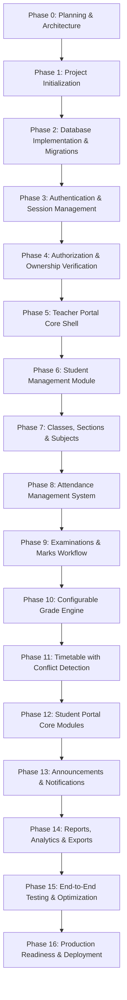

# Student Management System (SMS) - Development Roadmap & Phase Plan

**Document Version:** 1.0.0  
**Phase:** Phase 0 (Planning & Architecture)  
**Standard:** Strict sequential delivery with automated testing and quality gates.  

---

## Roadmap Overview

---

## Detailed Phase Breakdown

### Phase 0: Planning and Architecture (CURRENT)
- **Objectives:** Inspect development environment; draft complete system architecture, database schema, API contracts, security matrix, roadmap, and UI design specification.
- **Deliverables:** `ARCHITECTURE.md`, `DATABASE_SCHEMA.md`, `API_DOCUMENTATION.md`, `SECURITY.md`, `DEVELOPMENT_ROADMAP.md`.
- **Quality Gate:** Complete inspection, document consistency verification, and user approval.

---

### Phase 1: Project Initialization
- **Objectives:** Establish project scaffolding, package configurations, environment variables, and verify database connectivity.
- **Frontend Scaffolding:**
  - Next.js 15+ App Router with TypeScript.
  - Tailwind CSS configured with the `#0B1020` Enterprise Dark design palette.
  - Lucide React and Recharts installation.
  - Component directory tree (`components/ui`, `components/layout`, etc.).
- **Backend Scaffolding:**
  - FastAPI application structure (`app/core`, `app/models`, `app/api/v1`, etc.).
  - SQLAlchemy 2.0 configuration with PostgreSQL connection pool (and test connection setup).
  - Pydantic v2 schemas and validation settings.
  - Alembic initialization for schema migrations.
- **Deliverables:** Working backend greeting endpoint `/healthz`, compiling Next.js empty shell, unified environment configuration.
- **Quality Gate:** Backend starts cleanly; Frontend builds with 0 errors; database connection verified.

---

### Phase 2: Database Implementation & Migrations
- **Objectives:** Implement all 21 SQLAlchemy ORM models with strict constraints, foreign keys, and indexes; generate and apply Alembic migrations.
- **Deliverables:** SQLAlchemy models for all 21 tables, initial Alembic revision script, database seed script with sample departments, academic years, and initial administrator.
- **Quality Gate:** Migration runs cleanly forwards and backwards; test inserts and foreign key constraints succeed in automated pytest.

---

### Phase 3: Authentication & Session Management
- **Objectives:** Implement secure authentication system with Argon2 password hashing, JWT access/refresh token rotation, and login UI.
- **Deliverables:**
  - Backend: `/auth/login`, `/auth/refresh`, `/auth/logout`, `/auth/me`, `/auth/change-password`.
  - Frontend: Enterprise Dark Login screen with role-aware redirection.
- **Quality Gate:** Automated tests for successful login, invalid credentials, token expiration, and secure password changes.

---

### Phase 4: Authorization & Ownership Logic
- **Objectives:** Build FastAPI dependency injection guards for Teacher and Student roles, and enforce teacher-class ownership.
- **Deliverables:** Role-based route guards, ownership verification functions, IDOR prevention middleware.
- **Quality Gate:** Security tests verifying:
  - Teacher cannot access classes they do not instruct.
  - Student cannot access or mutate teacher routes.
  - Direct API requests with forged IDs return `403 Forbidden`.

---

### Phase 5: Teacher Portal Core Shell & Navigation
- **Objectives:** Implement the Teacher Portal layout: collapsible sidebar, responsive navbar, breadcrumbs, user profile dropdown, and initial dashboard view.
- **Deliverables:** Responsive layout shell, theme tokens, sidebar routing, authenticated layout wrapper.
- **Quality Gate:** Responsive test on desktop (1920x1080), tablet (768x1024), and mobile viewports.

---

### Phase 6: Student Management Module
- **Objectives:** Complete student directory, student enrollment, account provisioning with credentials generation, profile viewer, and status toggles.
- **Deliverables:** Student list table with search & filtering, Create Student modal form, Student Detail view, Account deactivation toggle.
- **Quality Gate:** Duplicate roll number check verified; student account creation generates functional login.

---

### Phase 7: Classes, Sections & Subjects
- **Objectives:** Management of departments, academic years, semesters, classes, sections, subjects, and teacher allocations.
- **Deliverables:** CRUD interfaces for Classes and Subjects, teacher-to-class assignment workflows.
- **Quality Gate:** Class capacity limits enforced; teacher-class relationship correctly populated.

---

### Phase 8: Attendance Management System
- **Objectives:** Full workflow for class attendance: session creation, roster roll-call, bulk mark (Present/Absent/Late/Excused), calculations, and correction logs.
- **Deliverables:** Attendance taker UI, monthly attendance grid, student-wise percentage calculation engine.
- **Quality Gate:** Duplicate attendance session prevention; percentage calculation mathematically verified.

---

### Phase 9: Examinations & Marks Management
- **Objectives:** Examination cycle setup, subject assessment definition, marks entry table with draft saving and validation ($0 \le \text{marks} \le \text{max}$), and publish workflow.
- **Deliverables:** Exam cycle manager, Marks entry matrix, Draft-to-Published state transition, student notification trigger.
- **Quality Gate:** Students cannot see draft marks; marks $> \text{max\_marks}$ rejected by API.

---

### Phase 10: Configurable Grade Engine
- **Objectives:** Grade scale configuration interface and automated grade computation algorithm.
- **Deliverables:** Grade scale settings UI, calculation engine mapping raw marks % to letter grades and grade points.
- **Quality Gate:** Dynamic grade scales can be modified without code changes; edge cases (exact threshold boundaries) verified.

---

### Phase 11: Timetable Management with Conflict Detection
- **Objectives:** Weekly timetable scheduler with real-time triple conflict detection (section overlap, teacher overlap, classroom overlap).
- **Deliverables:** Weekly grid view, slot creation form with instant conflict validation error alerts, daily schedule view.
- **Quality Gate:** Conflict engine catches overlapping periods for same room, same teacher, or same class.

---

### Phase 12: Student Portal Core Modules
- **Objectives:** Complete student portal experience: personal dashboard, read-only profile, attendance breakdown, published marks, semester grades, and weekly timetable.
- **Deliverables:** Student dashboard, My Attendance page with charts, My Marks & Grades page, My Timetable schedule view.
- **Quality Gate:** Verify student cannot modify any records; student views only their own data.

---

### Phase 13: Announcements & Notifications
- **Objectives:** Teacher announcement broadcast system with target audience filters; direct in-app notification alerts for students.
- **Deliverables:** Announcement composer, announcement feed, notification bell dropdown with unread badge.
- **Quality Gate:** Target filtering verified (class-specific announcement only visible to enrolled students).

---

### Phase 14: Reports, Analytics & Exports
- **Objectives:** Academic analytics dashboards with Recharts; CSV and printable PDF export for attendance sheets and student transcripts.
- **Deliverables:** Analytics charts, class report generators, printable student report cards.
- **Quality Gate:** Reports render correctly on printable formats; CSV exports accurately reflect database records.

---

### Phase 15: End-to-End Testing & Performance Optimization
- **Objectives:** Pytest test suites across all endpoints, frontend component tests, database indexing optimization, query performance analysis.
- **Deliverables:** Automated test reports, security penetration test audit log, optimized query plans.
- **Quality Gate:** 100% critical academic and security tests pass.

---

### Phase 16: Production Readiness & Deployment
- **Objectives:** Docker compose multi-container orchestration (FastAPI + Next.js + PostgreSQL), backup scripts, environment setup guide.
- **Deliverables:** Production Dockerfiles, docker-compose.yml, deployment and disaster recovery guide.
- **Quality Gate:** Clean container startup and automated database backup verification.

