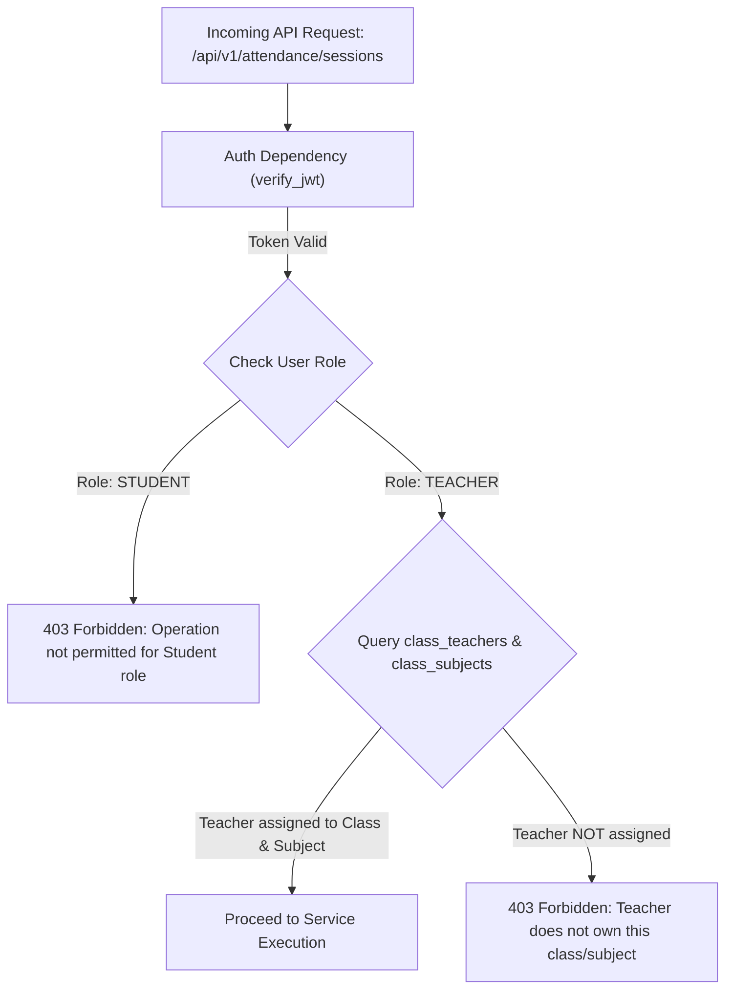

# Student Management System (SMS) - Security Architecture & Permission Matrix

**Document Version:** 1.0.0  
**Phase:** Phase 0 (Planning & Architecture)  
**Security Standard:** OWASP Top 10 API Security Compliant  

---

## 1. Authentication Architecture

### 1.1 Password Security
- **Hashing Algorithm:** Argon2id (memory cost: 65,536 KiB, time cost: 3 iterations, parallelism: 4) or Bcrypt (work factor 12).
- **Password Policy:** Minimum 8 characters, requiring at least 1 uppercase letter, 1 lowercase letter, 1 digit, and 1 special symbol.
- Plaintext passwords are never logged, cached, or transmitted in unencrypted formats.

### 1.2 Token Lifecycle
- **Access Tokens:** Short-lived JSON Web Tokens (JWT) signed with `HS256` or `RS256`, validity of **15 minutes**.
  - Payload contents: `sub` (User UUID), `role` (`TEACHER` or `STUDENT`), `profile_id` (Teacher/Student Profile UUID), `exp`, `iat`, `jti`.
- **Refresh Tokens:** Opaque cryptographically random UUID tokens stored in a secure table or hashed in database, validity of **7 days**. Rotated upon every refresh exchange.
- **Cookies / Transport:** Delivered via HTTP-only, `Secure`, `SameSite=Strict` cookies or `Authorization: Bearer <token>` headers for cross-origin API compatibility.

---

## 2. Role-Based Access Control (RBAC) Matrix

| Domain / Resource | Operation | Teacher | Student | Public / Unauth |
| :--- | :--- | :---: | :---: | :---: |
| **Authentication** | Login, Refresh Token | Allowed | Allowed | Allowed |
| | Change Password | Own Account | Own Account | Denied |
| **Teacher Profiles** | View Profile | Own Profile | Class Teacher Only | Denied |
| | Update Permitted Details | Own Profile | Denied | Denied |
| **Student Profiles** | View Directory / Search | Assigned Classes | Denied | Denied |
| | View Individual Profile | Assigned Classes | Own Profile Only | Denied |
| | Create Student Account | Allowed | Denied | Denied |
| | Edit Demographics / Status | Allowed | Denied | Denied |
| **Classes & Sections** | View Assigned Classes | Assigned Classes | Enrolled Class Only | Denied |
| | Create Class / Section | Allowed | Denied | Denied |
| | Assign Class Teacher | Assigned / Admin | Denied | Denied |
| **Subjects** | View Subjects | Assigned / Dept | Enrolled Subjects | Denied |
| | Create / Modify Subject | Allowed | Denied | Denied |
| **Enrollments** | Enroll / Transfer Students | Allowed | Denied | Denied |
| **Attendance** | Create Attendance Session | Assigned Class/Subject | Denied | Denied |
| | Submit / Edit Attendance | Assigned Class/Subject | Denied | Denied |
| | View Attendance Records | Assigned Class/Subject | Own Records Only | Denied |
| **Examinations** | Create Exam / Assessment | Allowed | Denied | Denied |
| | Enter / Save Draft Marks | Assigned Class/Subject | Denied | Denied |
| | Publish Marks | Assigned Class/Subject | Denied | Denied |
| | View Marks | Assigned Class/Subject | Published Marks Only | Denied |
| **Grades** | Configure Grade Scales | Allowed | Denied | Denied |
| | Calculate & Publish Grades | Assigned Class | Denied | Denied |
| | View Calculated Grades | Assigned Class | Own Published Grades | Denied |
| **Timetable** | Create / Update Schedule | Assigned Classes | Denied | Denied |
| | View Timetable | Own Schedule + Assigned | Enrolled Class Schedule | Denied |
| **Announcements** | Post / Edit Announcement | Allowed | Denied | Denied |
| | View Announcements | Relevant Announcements| Relevant Announcements | Denied |
| **Audit Logs** | View Audit Logs | Read-Only (Auditor/Teacher)| Denied | Denied |

---

## 3. Data Ownership Enforcement Model

Permission enforcement is executed at the **FastAPI Dependency Injection** and **SQLAlchemy Repository** layers. Frontend UI visibility flags are strictly cosmetic; direct API requests without valid ownership tokens are rejected with `403 Forbidden`.



### 3.1 Teacher Ownership Verification Algorithm
When a teacher submits attendance or enters marks:
```python
async def verify_teacher_class_access(
    teacher_id: UUID, 
    class_id: UUID, 
    db: AsyncSession
) -> bool:
    # Check if teacher is assigned as class teacher or subject teacher
    is_class_teacher = await db.scalar(
        select(exists().where(
            ClassTeacher.teacher_id == teacher_id,
            ClassTeacher.class_id == class_id
        ))
    )
    if is_class_teacher:
        return True
    return False
```

### 3.2 Student Ownership Verification Algorithm
Students are prevented from supplying another student's identifier:
```python
async def get_current_student(
    current_user: User = Depends(get_current_user),
    db: AsyncSession = Depends(get_db)
) -> StudentProfile:
    if current_user.role != UserRole.STUDENT:
        raise HTTPException(status_code=403, detail="Student credentials required")
    student = await db.scalar(
        select(StudentProfile).where(StudentProfile.user_id == current_user.id)
    )
    if not student:
        raise HTTPException(status_code=404, detail="Student profile not found")
    return student
```
All student queries use `WHERE student_id = current_student.id` at the query builder layer, completely eliminating Insecure Direct Object References (IDOR).

---

## 4. Threat Model & Mitigation Strategy

| Threat Category | Risk Description | SMS Mitigation Strategy |
| :--- | :--- | :--- |
| **IDOR (BOLA)** | Student tries to view another student's marks or attendance by altering URL UUIDs. | Strict token-derived identity resolution (`current_student.id`). Client path parameters cannot override token context. |
| **Unauthorized Grade Modification** | Malicious actor submits marks update payload directly to backend. | Rigorous ownership checks, marks validation ($0 \le \text{marks} \le \text{max\_marks}$), draft vs. published state machine, and mandatory audit log entries. |
| **Brute Force / Credential Stuffing** | Automated login attempts against faculty accounts. | Slow down brute-force via IP + username rate limiting (5 attempts per minute max), progressive backoff, and Argon2id computational resistance. |
| **SQL Injection** | Attacker injects raw SQL through search or filter parameters. | 100% Parameterized queries through SQLAlchemy 2.0 ORM. Direct raw string interpolation is strictly prohibited. |
| **Cross-Site Scripting (XSS)** | Attacker posts malicious script inside an Announcement or Remarks field. | HTML sanitization and encoding on server ingestion; React automatic string escaping on render. |
| **Privilege Escalation** | Student attempts self-registration as a faculty member. | Public registration endpoint does not exist. Teacher accounts require secure provisioning; student accounts are generated exclusively by authorized faculty. |

---

## 5. Audit Logging Architecture

Every security-sensitive or academic-integrity-impacting operation automatically creates an immutable record in `audit_logs`:

1. **Events Logged:**
   - User authentication success and failure
   - Student account creation and deactivation
   - Attendance session creation and retrospective corrections
   - Marks creation, update, and formal publication
   - Grade scale definition changes
   - Timetable modifications
2. **Recorded Attributes:**
   - Timestamp with microsecond precision (`TIMESTAMPTZ`)
   - Actor user UUID and remote IP address
   - Action name and target entity type & UUID
   - Pre-change state snapshot and Post-change state snapshot (`JSONB`)

